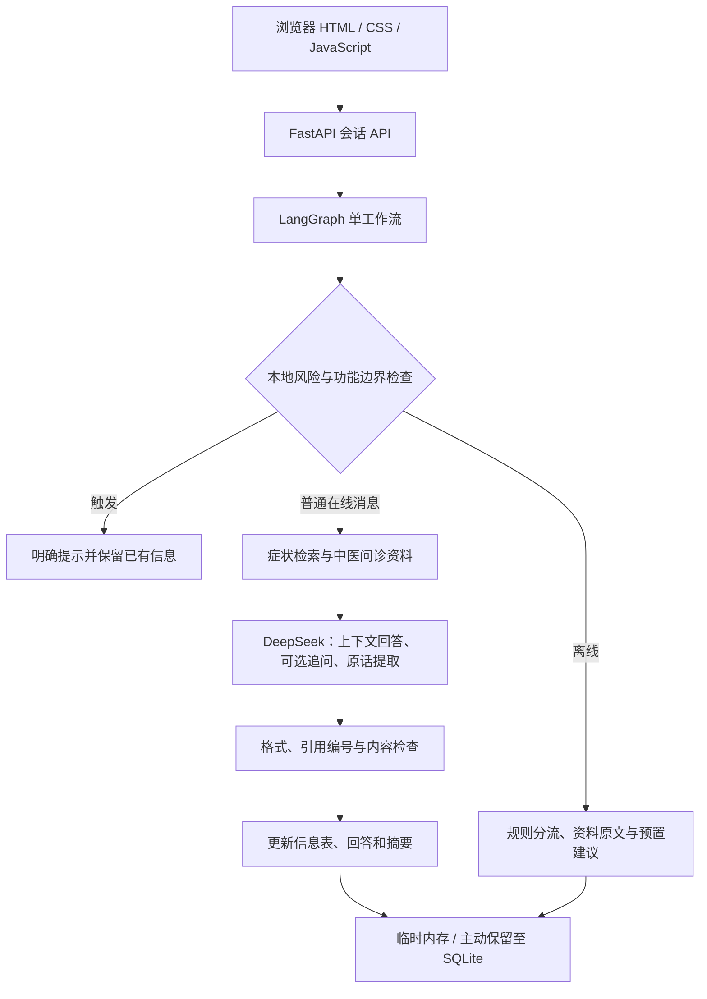

# 铉问 · 中医智能问诊助手

基于 **FastAPI、LangGraph、DeepSeek 和本地 RAG** 的文字问诊信息整理与知识问答项目。通过连续对话理解用户描述，按中医问诊维度记录信息，结合本地资料解释，并生成 Markdown 就诊沟通摘要。

本项目用于学习与功能演示。文字交流不能完成完整四诊，系统不提供个人确诊、证候结论、中药处方或剂量。


> 截图使用虚构开发输入。仓库不包含开发者的 API 密钥、Windows 密文、个人会话数据库或本地上传的知识手册。

## 主要功能

- **连续对话**：在线每轮携带最近12条消息、已记录信息及上一句追问，由模型理解省略、补充和插入问题，自主决定是否追问。
- **中医问诊维度**：选择性关注寒热与汗出、饮食口味口渴、大小便、睡眠与情绪，显示相关问诊关注点，不按固定顺序要求填满表格。
- **信息自动整理**：仅采纳本轮原话片段，保留明确否定，区分总病程、发作间隔和单次时长；右侧可手工核对。
- **本地 RAG**：解析 PDF/TXT/Markdown，保留 PDF 页码，使用中文字符 TF-IDF 与余弦相似度检索；症状检索扩展常用同义表达，并筛选解释性片段。
- **依据与模型补充**：只展示本次实际引用的资料。资料以外的一般解释单独标为“模型补充，未获本知识库支持”。
- **记录与导出**：临时会话保存在进程内存；主动保留的会话写入 SQLite，可查看历史并导出带中医信息分组的 Markdown 摘要。
- **离线整理**：不配置或不开启模型也能使用本地规则整理、资料查询和预置建议；页面区分在线、离线及失败状态。
- **密钥保护**：Windows 支持当前用户 DPAPI 加密存储；后端自动读取，不把密钥发送给浏览器。

## 架构与调用流程



正常在线消息每轮请求一次模型；查看已生成建议、读取会话和导出摘要不重复请求。接口异常会明确提示，不用本地固定回答冒充模型成功返回。

技术栈：Python、FastAPI、LangGraph、HTTPX、scikit-learn、pypdf、SQLite、原生 HTML/CSS/JavaScript。无需 Node.js、向量数据库或多智能体服务。

## 快速运行

建议 Python 3.11 或 3.12。以下命令在项目根目录执行。

### Windows / PowerShell

```powershell
python -m venv .venv
.\.venv\Scripts\python.exe -m pip install -r requirements.lock.txt
.\.venv\Scripts\python.exe run.py --open
```

浏览器访问 <http://127.0.0.1:8601/>。环境建立后，也可双击 `启动铉问.cmd`。

在 PyCharm 中打开整个项目目录，选择 `.venv\Scripts\python.exe` 作为解释器，再运行根目录 `run.py`。端口已占用可使用 `run.py --port 8602`。

### macOS / Linux

```bash
python3 -m venv .venv
.venv/bin/python -m pip install -r requirements.lock.txt
.venv/bin/python run.py --open
```

Windows DPAPI 存储仅适用于 Windows；其他系统使用自己的环境变量配置密钥。

## 配置 DeepSeek

每位使用者需要自己的 API 密钥。未配置时仍可使用离线功能。

### Windows：加密保存（推荐）

```powershell
Copy-Item .env.example .env
.\.venv\Scripts\python.exe 设置DeepSeek密钥.py
```

按提示隐藏输入。脚本调用 Windows DPAPI 加密保存到：

```text
%LOCALAPPDATA%/Xuanwen/secrets/deepseek-key.dpapi
```

密文位于项目之外；`.env` 的密钥值为空，并设置 `DEEPSEEK_KEY_STORAGE=windows_dpapi`。后端自动读取，平时仍直接运行 `run.py`。控制台不支持隐藏输入时，脚本停止并提示改用终端。

### 其他系统或部署环境

提供自己的环境变量：

```text
ENABLE_LLM=true
LLM_PROVIDER=deepseek
DEEPSEEK_KEY_STORAGE=env
DEEPSEEK_API_KEY=<你的密钥>
DEEPSEEK_MODEL=deepseek-flash
DEEPSEEK_BASE_URL=https://api.deepseek.com
LLM_TIMEOUT_SECONDS=30
```

模型名可调整为账户支持的型号。环境变量优先于本地配置；不要将真实密钥写入源码或提交到仓库。

配置后点击“检查 DeepSeek 连接”，勾选“使用 DeepSeek 智能对话（立即生效）”。连接检查只发送测试消息，不发送问诊历史；也可运行 `测试DeepSeek连接.py`。

## 知识库与复现范围

首次启动会生成本地数据库并初始化 **6份带来源链接的内置知识整理稿**。默认资料主要介绍四诊范围、问诊信息分类及系统边界，不能覆盖全部中医问题。

开发演示曾导入并重点校对一份77页手册，截图及历史验证记录可能包含这份本地资料；**该 PDF、校对文本及导入后的数据库不在仓库中**。新下载的项目不会自动带有这份手册或原有7份资料状态。

如需扩展：进入“知识库”，上传自己有权使用的 PDF/TXT/Markdown，核对来源后手动启用。上传资料默认停用，单文件不超过5 MB，扫描版 PDF 需先 OCR。详情见 [知识手册导入说明](知识手册导入说明.md) 和 [手册知识核验记录](手册知识核验记录.md)。

检索分数仅表示文本相关性，不是医学置信度；输出带引用也不能证明医学内容正确。

## 目录结构

```text
backend/
  main.py          # API、会话、资料管理与网页入口
  workflow.py      # 单一工作流、在线与离线分支、摘要
  llm.py           # DeepSeek调用、上下文回答与输出检查
  tcm.py           # 中医问诊信息维度与参考资料
  rag.py           # 症状扩展、解释性片段与上下文版本
  knowledge.py     # 内置资料、文档解析、TF-IDF检索
  advice.py        # 离线建议与缓存签名
  intent.py        # 离线意图与字段整理
  secret_store.py  # Windows当前用户DPAPI存储
  storage.py       # SQLite读写
frontend/          # 页面、样式与浏览器交互
scripts/           # 特定手册的开发辅助处理脚本
tests/            # 功能、回归与加密存储测试
run.py             # 启动入口
.env.example       # 空密钥配置模板
```

更详细的说明见 [项目讲解](项目讲解.md)、[DeepSeek接入说明](DeepSeek接入说明.md) 和 [验证记录](验证记录.md)。历史验证记录描述开发者本机的演示状态，不代表新安装环境已配置同样的密钥或资料。

## 验证

```powershell
.\.venv\Scripts\python.exe -m pytest -q
.\.venv\Scripts\python.exe run.py --check
```

开发环境最近一次完整测试：**127项通过**。测试覆盖连续对话、信息提取、中医维度、知识资料与版本、会话及摘要、模型失败、引用检查和 Windows 密钥加密。非 Windows 环境会跳过真实 DPAPI 测试。真实 DeepSeek 联调使用虚构开发输入，未进行临床有效性或医学准确率评估。

## 数据与密钥

- `.env`、`*.dpapi`、`.idea/`、虚拟环境、数据库、上传资料、联调记录及运行日志均被忽略；提交前仍需检查文件清单。
- 临时会话重启即消失；主动保留的记录以明文写入本机 SQLite，数据库未加密。
- 开启在线会话后，相关描述、近期聊天和检索资料会发送给模型供应商，并可能产生调用费用。
- DPAPI 通常绑定当前 Windows 用户及本机；它不阻止同一用户下的程序解密，运行中密钥仍需进入后端内存。更换电脑或用户后重新设置密钥。
- 默认服务只监听 `127.0.0.1`，是本机单用户项目。公开网页部署需要另行完善身份验证、隐私和运维措施。

资料范围参考 [市场监管总局四诊标准解读](https://www.samr.gov.cn/bzjss/bzjd/art/2022/art_d96f4e909dd04ed082b20b5fdf87e84a.html)，Windows 加密机制参考 [Microsoft DPAPI 文档](https://learn.microsoft.com/en-us/windows/win32/api/dpapi/nf-dpapi-cryptprotectdata)。
